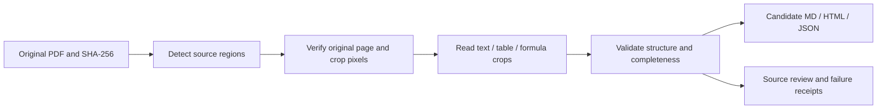

# Local layout-guided reading

PDF2Data now has an opt-in path for source-bound text, table and formula
recognition. It preserves the existing extraction and produces a new candidate
bundle. Model output is not a reviewed legal interpretation or a replacement
for the original PDF.

The detector uses cached Docling Heron on PyTorch MPS. The reader uses the cached
[MLX PaddleOCR-VL-1.5 conversion](https://huggingface.co/mlx-community/PaddleOCR-VL-1.5-4bit),
revision `3404726b40ac30b6e4e3d37c504e3f96c9c6c984`, on Apple Metal. This is the
cached 1.5 conversion; it is not a claim to use the latest PaddleOCR model.
Fixed prompts follow the [upstream task interface](https://huggingface.co/PaddlePaddle/PaddleOCR-VL-1.5):
`OCR:`, `Table Recognition:` and `Formula Recognition:`. No query, expected
answer or benchmark annotation enters a prompt.

## Workflow



Prepare a source manifest; `path` points to the original PDF and `sha256` is its
actual content digest. IDs must contain only letters, digits, underscores or
hyphens. Page count is optional and is checked when supplied.

```json
{
  "schema_version": "pdf2data.source-batch.v1",
  "sources": [
    {"id": "example", "path": "/absolute/path/source.pdf", "sha256": "ACTUAL_PDF_SHA256", "pages": 6}
  ]
}
```

Run the two stages through the CLI with their isolated installed environments:

```bash
PDF2DATA_PYTHON=/path/to/docling-python ./pdf2data pdf-layout-detect \
  --manifest sources.json --output out/layout --device mps --dpi 180 --json

PDF2DATA_PYTHON=/path/to/mlx-vlm-python ./pdf2data pdf-region-read \
  --layout out/layout/layout.json --output out/structured \
  --device gpu --max-tokens 4096 --json
```

Use new output folders. `pdf-region-read --resume` accepts the same layout,
implementation, model files, runtime, device and token contract. It rechecks
original PDF/crop pixels and reuses successful readings; it retries failed
regions. It does not silently accept changed source/model inputs. Forced GPU
requests fail if the requested runtime is unavailable.

## Outputs

| Stage | File | Contents |
| --- | --- | --- |
| Detect | `layout.json` | Original PDF hashes, physical pages, page/crop raster hashes, source coordinates, candidate order, visual regions and ink-coverage diagnostics |
| Detect | source PNGs and region crops | Exact original page renders and bounded crops; the original PDF is unchanged |
| Read | `contract.json` | Layout/model/runtime/configuration identity used for resume |
| Read | `<source-id>/readings.json` | Raw task responses, source crop bindings, timings and reading failures |
| Read | `<source-id>/pages.jsonl` | Body projection, raw region text, candidate blocks, furniture, visual-review regions and coverage diagnostics |
| Read | `<source-id>/tables.json` | Explicit cells, blank positions, row/column spans, source-crop references and unreviewed status |
| Read | `<source-id>/document.md` | Continuous body with candidate tables and LaTeX formulas in proposed source order |
| Read | `<source-id>/document.html` | Local safe HTML rendering of the candidate blocks and review indicators |
| Read | `<source-id>/document.json` | Combined pages/tables with original PDF identity and path |
| Read | `read.json` | Actual devices, model hashes, timings, peak device memory and per-document failure counts |

The source layout records every detected region. Text fully contained inside
exactly one table box is retained as owned evidence and is not separately read
and duplicated beside the whole-table reading. Partial overlaps stay separate.
Recursive whitespace cuts propose column order without using source text or
benchmark labels. That order remains unverified.

Tables can arrive as HTML or OTSL. OTSL continuation tokens produce explicit
rectangular merges; malformed links, hidden text on continuation cells,
nonrectangular merges, ragged rows and truncated HTML are rejected. Blank cells
stay blank. No adjacent value is copied into a blank position. The raw response
remains available even when its parsed representation is rejected.

The readable body excludes detector-classified page headers/footers; they remain
in captured blocks and raw region text. Figures remain explicit visual-review
items. Dark pixels outside detected boxes are counted, not silently labelled
covered. Consequently, processing every page does not establish complete text
capture. Re-rendered crop integrity proves the input pixels, not OCR spelling,
semantic coverage, or the detector's classification.

## Compare on the unchanged external suite

```bash
./pdf2data benchmark-run --suite out/benchmarks/public-70/suite.json \
  --profile layout-vlm --workers 1 \
  --parser-python /path/to/mlx-vlm-python \
  --layout-python /path/to/docling-python \
  --output out/benchmarks/layout-vlm --json

./pdf2data benchmark-score --suite out/benchmarks/public-70/suite.json \
  --run out/benchmarks/layout-vlm --upstream out/benchmarks/vendor/olmocr \
  --eval-python out/benchmarks/eval-venv/bin/python --mode tables \
  --output out/benchmarks/score-layout-vlm --json
```

The driver passes only source IDs, PDF paths, hashes and page counts to processing
stages. Every selected case remains in the denominator. Any failed attempted
region makes its document an extraction failure for scoring; partial artifacts
are retained for inspection. Figures/uncovered ink are separate unresolved
coverage diagnostics, so a completed case must not be called verified complete.

This is a whole-pipeline comparison. It changes recognition, region ordering,
table representation and furniture projection. Its single batched GPU reader
also differs from the four-process native/automatic baseline. Do not attribute
all score changes to the model, or compare these timings as isolated model
inference speed. The existing native/automatic path remains available.

## Preserve source tables without overriding visual evidence

`pdf-table-reconcile` keeps both grids. It can select original native cells only
when region/cell glyph and order checks pass and the visual reader supports their
values and symbols. Body-token case stays exact (`MW` differs from `mW`); numeric
punctuation is retained. It does not establish legal or painted-pixel correctness.

```bash
# native/<source-id> must be a source-verified pdf-extract package.
./pdf2data pdf-table-reconcile --layout out/layout/layout.json \
  --read out/structured --native-packages out/native --output out/reconciled --json

./pdf2data benchmark-reconcile-tables --suite out/benchmarks/public-70/suite.json \
  --run out/benchmarks/layout-vlm --native-run out/benchmarks/native \
  --output out/benchmarks/reconciled --json
```

Reconciled folders retain model/native tables, captured original glyph geometry,
per-region decisions and continuous Markdown/HTML/JSON. Rejected native candidates
remain diagnosable; conflicting content is not silently promoted. This stage
reruns native source checks, not model inference. Derived benchmark receipts are
marked non-fresh, with reconciliation time separate from inherited reading time.

For an updated layout, `pdf-region-read --reuse-readings PREVIOUS_READ_ROOT` can
reuse successful outputs only when source PDF/page/crop/task, model files,
prompts, runtime and device match. Its contract records parent receipt hashes.
`benchmark-run --profile layout-vlm` exposes the same `--reuse-readings` option.
Do not report incremental/reused processing as a fresh speed benchmark.

Tested runtime pins are in `requirements/structured-layout.txt` and
`requirements/structured-reader.txt`. Detector weights/config are pinned to
Heron revision `8f39ad3c0b4c58e9c2d2c84a38465abf757272d8`. Detector and reader
weights must already be cached; inference is offline. Both upstream projects'
licences apply to their models/libraries. [Measured results](2026-10-31-layout-results.md).
